

This page details the current arrangement of my pedalboard, including the looping and recording setup around it. Usually I'm playing guitar, but I also plug in other instruments or put a microphone in front of them. For more of the story of how I got here, check out [the pedalboard series]({{ '/tags/pedalboard.html' | absolute_url }}).

## Signal Chain

Two potential inputs meet at an A/B switch. The instrument branch goes through fuzz first; the microphone branch goes to a mic preamp and shaper. After either input is selected at the A/B switch, the rest is identical.

### Input Branches

- Direct instrument → [JHS Bender](https://reverb.com/marketplace?query=JHS%20Bender) → [JHS Mini A/B Switch](https://reverb.com/p/jhs-mini-a-slash-b-switch)
- [Shure SM57](https://reverb.com/p/shure-sm57) → [JHS Color Box V2](https://reverb.com/marketplace?query=JHS%20Color%20Box%20V2) → [JHS Mini A/B Switch](https://reverb.com/p/jhs-mini-a-slash-b-switch)

### Main Board

1. [Walrus Audio Mira Optical Compressor](https://reverb.com/marketplace?query=Walrus%20Audio%20Mira%20Optical%20Compressor)
1. [TC Electronic PolyTune 3 Mini](https://reverb.com/marketplace?query=TC%20Electronic%20Polytune%203%20Mini%20Polyphonic%20Tuning%20Pedal%202019)
1. [EHX Pitch Fork Polyphonic Pitch Shifter](https://reverb.com/marketplace?query=Electro-Harmonix%20Pitch%20Fork)
1. [JHS NOTAKLÖN](https://reverb.com/p/jhs-notaklon)
1. [JHS NOTADÜMBLË V1](https://reverb.com/p/jhs-notadumble)
1. [Walrus Audio Lillian Multi-Stage Analog Phaser](https://reverb.com/marketplace?query=Walrus%20Audio%20Lillian%20Multi-Stage%20Analog%20Phaser%202018)
1. [Walrus Audio Julia Chorus / Vibrato V2](https://reverb.com/marketplace?query=Walrus%20Audio%20Julia%20Chorus%20Vibrato%20V2)
1. [EHX Holy Grail Nano Reverb](https://reverb.com/marketplace?query=Electro-Harmonix%20Holy%20Grail%20Nano%20Reverb)
1. [Walrus Audio Monument Harmonic Tap Tremolo V2 (Kamakura)](https://reverb.com/p/walrus-audio-monument-harmonic-tap-tremolo-v2)
1. [JHS Flight Delay](https://reverb.com/p/jhs-flight-delay)
1. [EarthQuaker Devices Afterneath V3](https://reverb.com/p/earthquaker-devices-afterneath-otherworldly-reverberation-machine-v3)

### Baby Board

1. [Old Blood Noise Endeavors Dark Star Stereo](https://oldbloodnoise.com/pedals/p/dark-star-stereo) (mono input; stereo output from here onward)
1. [Strymon Iridium](https://reverb.com/p/strymon-iridium)
1. [Boss RC-10R Rhythm Loop Station](https://reverb.com/marketplace?query=Boss%20RC-10R%20Rhythm%20Loop%20Station%202019)

A [Boss FS-7 Footswitch](https://reverb.com/p/boss-fs-7-footswitch) adds additional control to the RC-10R.

### Looping

1. [Boss RC-600 Loop Station](https://www.boss.info/global/products/rc-600/)

### Output

1. [Allen & Heath ZEDi-10 Compact 10-Input Hybrid Mixer/USB Interface](https://reverb.com/p/allen-and-heath-zedi-10-compact-10-input-hybrid-mixer-slash-usb-interface)
1. [HeadRush FRFR-108](https://reverb.com/marketplace?query=Headrush%20FRFR-108), stereo pair for monitors

From the mixer I also have headphone monitoring and USB recording.

## Details

### [JHS Bender](https://reverb.com/marketplace?query=JHS%20Bender)
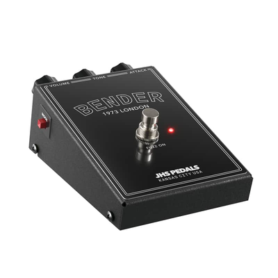

My pedal from the Legends of Fuzz series is based on the classic Tone Bender. I prefer it over any other fuzz I've tried thus far. Great sustain, great presence, and I can dial in the amount with my guitar's volume knob.

### [JHS Color Box V2](https://reverb.com/marketplace?query=JHS%20Color%20Box%20V2)
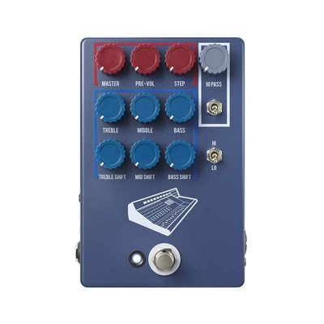

This is the direct-to-Neve-console-inspired pedal. It takes my microphone input and has a bunch of controls to shape the sound and get it to a level I can use with the rest of the board. I'm using a [Shure SM57](https://reverb.com/p/shure-sm57) on a [DR Pro mic stand](https://www.guitarcenter.com/DR-Pro/Tripod-Mic-Stand-With-Telescoping-Boom-1275776905388.gc).

Honestly, I barely know how to make use of this pedal beyond being a mic preamp. It has a lot of controls, and I find it intimidating. It does the thing I need, but it's an expensive solution when I already own an [ART Tube MP Studio V3](https://reverb.com/p/art-tube-mp-studio-v3-tube-microphone-preamp-2010-2023). My hope is I can grow into it.

### [JHS Mini A/B Switch](https://reverb.com/p/jhs-mini-a-slash-b-switch)
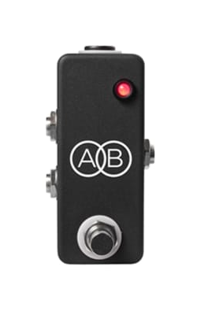

The goal of the board is to enable me to be creative in real time. Bending down to unplug one instrument and connect another gets in the way of being present. With a quick tap here I can switch between the Stratocaster and the bouzouki, or between a keyboard and a trumpet. Both inputs go through the effects after the switch; only the direct instrument goes through the fuzz.

## Main Board

[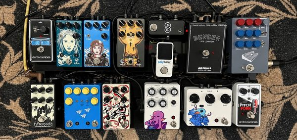](/media/pedalboard-2026-main.jpg)

### [Walrus Audio Mira Optical Compressor](https://reverb.com/marketplace?query=Walrus%20Audio%20Mira%20Optical%20Compressor)
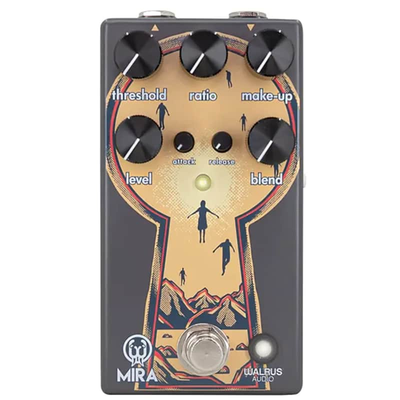

I use the Mira when I want more consistency in the dynamics of my playing, or more sustain. It gets a fair amount of use as just that, but I haven't really figured out what I like or dislike about compressors. I chose this because it was described as "a compressor if you don't get on well with compressors." So, yep, still me.

### [TC Electronic PolyTune 3 Mini](https://reverb.com/marketplace?query=TC%20Electronic%20Polytune%203%20Mini%20Polyphonic%20Tuning%20Pedal%202019)
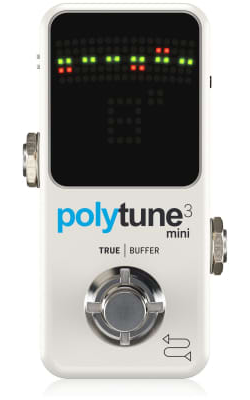

On many instruments I use a [headstock clip-on tuner](https://www.cherubtechnology.com/productinfo/928687.html), but I also have this on-board tuner after the compressor. The Polytune can show the tuning of all your strings with an open strum, which is neat but not something I turn to often. I find the live readout of whatever pitch I'm playing more useful, especially when piping a horn or another unfamiliar instrument through the microphone.

### [EHX Pitch Fork Polyphonic Pitch Shifter](https://reverb.com/marketplace?query=Electro-Harmonix%20Pitch%20Fork)
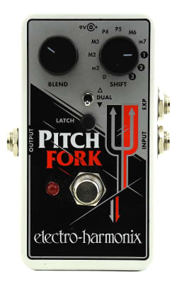

One of my most used pedals, primarily because it's quicker to shift my guitar down an octave than to swap in a proper bass guitar. When I'm laying down a rough draft of a loop, I'm gonna want a bass line, and this gets me there fast. Mind you, it does a ton more than that. It can thicken your sound by adding octaves above and/or below, with or without the dry signal. Or you can do the same thing with fifths (power chords all day), fourths, thirds, or even a warbly detune.

### [JHS NOTAKLÖN](https://reverb.com/p/jhs-notaklon)
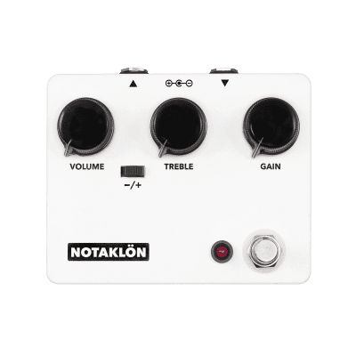

The [pitch video](https://youtu.be/LJGos1D1ha8?si=U-NcZMsDZCWp2nDp) for this DIY kit absolutely stole my heart. My daughter built it for me, and I will always treasure this pedal. You wouldn't recognize it from the illustrated enclosure, given the sticker customization, but it's a NOTAKLÖN.

Do I like the sound? Absolutely. It's a nice dirty overdrive with crunch and flavor, and I use it regularly. It stacks well with other dirt pedals.

### [JHS NOTADÜMBLË V1](https://reverb.com/p/jhs-notadumble)
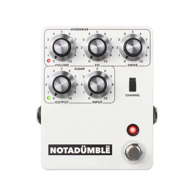

I have the original "mistake" version. Its clean side is on almost all the time, adding a boost that I like the tone of. There's also an overdrive mode I can switch on for another flavor, but I use that far less often. Again, my daughter built the pedal, and we personalized it with a fun sticker.

### [Walrus Audio Lillian Multi-Stage Analog Phaser](https://reverb.com/marketplace?query=Walrus%20Audio%20Lillian%20Multi-Stage%20Analog%20Phaser%202018)
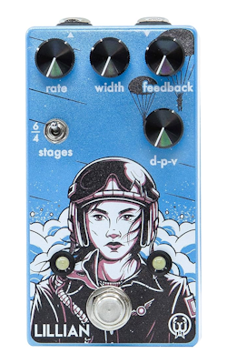

I could never get my old [Small Stone](https://reverb.com/marketplace?query=Electro-Harmonix%20Nano%20Small%20Stone%20EH4800%20Phase%20Shifter%20V2%202021) subtle enough for frequent use. The Lillian fixes that handily with a mix knob, plus plenty of controls to dial in gentle (or not gentle) phasing. I often use it with fuzz or distortion. And the art on this pedal is great.

### [Walrus Audio Julia Chorus / Vibrato V2](https://reverb.com/marketplace?query=Walrus%20Audio%20Julia%20Chorus%20Vibrato%20V2)
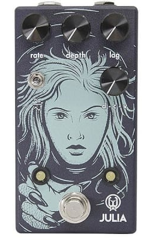

Chorus hasn't been an effect I prioritize highly. I opted for the Julia over the more advanced stereo [Julianna](https://reverb.com/marketplace?query=Walrus%20Audio%20Julianna%20Deluxe%20Chorus%2FVibrato&product_type=effects-and-pedals), and found I'm far more likely to use a mild chorus. But honestly, more often I turn the mix all the way to vibrato (no clean signal, only the modulated signal), because a little warble is nice. Both configurations get used.

### [EHX Holy Grail Nano Reverb](https://reverb.com/marketplace?query=Electro-Harmonix%20Holy%20Grail%20Nano%20Reverb)
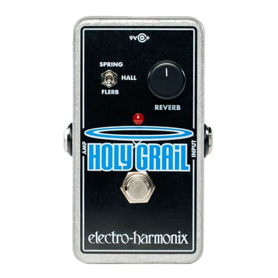

This is my simple reverb. It's almost always on with a light bit of spring reverb; sometimes I use hall. I've used fancier reverb pedals, but this does the thing without being complicated, and I have enough complicated pedals.

### [Walrus Audio Monument Harmonic Tap Tremolo V2](https://reverb.com/p/walrus-audio-monument-harmonic-tap-tremolo-v2)
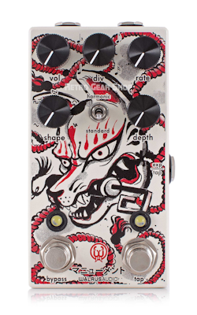

I _really_ like tremolo, so I got a fancy tremolo. The important feature is tap tempo: I can mash in the rate with my foot and match what I'm playing, then choose subdivisions with a knob. Usually I use a smooth waveform, with square available for something choppier. It also has harmonic tremolo, which I don't use much.

### [JHS Flight Delay](https://reverb.com/p/jhs-flight-delay)
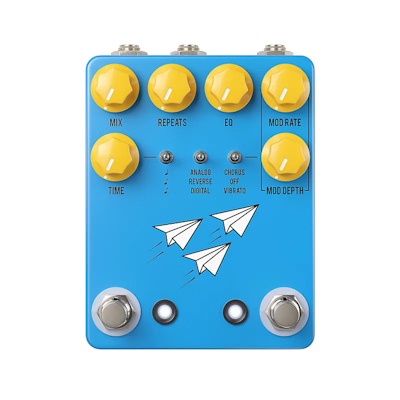

Getting a delay timing dialed in with a knob is not fun. Tap tempo is essential for setting up certain types of delay, and there's a knob for the subdivisions. A lot of what drew me to this pedal was the user interface; the way the functions are divided between switches and knobs is intuitive.

### [EarthQuaker Devices Afterneath V3](https://reverb.com/p/earthquaker-devices-afterneath-otherworldly-reverberation-machine-v3)
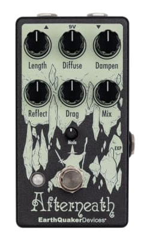

I didn't need this pedal, but it has a wizard on it and an awesome name, so I wanted it. And I love the cavernous space it creates. I like throwing it on as soon as I know it won't overwhelm the mix, because it adds a lot of emotive space. This is the ambient reverb I reach for most often.

## Baby Board

[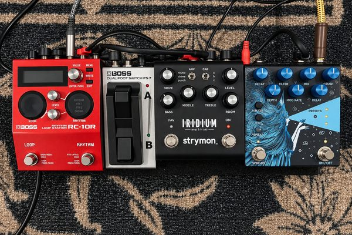](/media/pedalboard-2026-babyboard.jpg)

The [Pedaltrain Nano](https://pedaltrain.com/collections/nano/products/pt-nano-sc) is my portable core. I've taken it into guitar stores to try instruments with headphones on for private testing and access to a familiar setup and pre-built accompaniment. This board starts the stereo portion of my setup: mono in, stereo out from here onward.

### [Old Blood Noise Endeavors Dark Star Stereo](https://oldbloodnoise.com/pedals/p/dark-star-stereo)
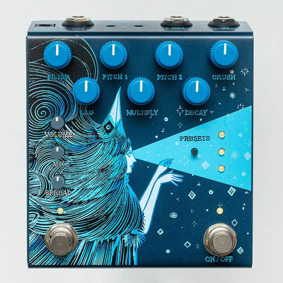

I got this because it's pretty (yes, that genuinely matters to me) and because it sounded like it could do interesting ambient things. What it does can be a bit overwhelming, though. I like its bitcrushing and stereo spreads, but I'm still figuring out how to harness the pedal consistently. If I'm honest, I use the Afterneath more often.

### [Strymon Iridium](https://reverb.com/p/strymon-iridium)
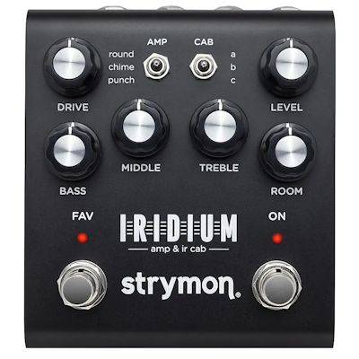

This simulates an amp and cabinet, with Fender-, Vox-, and Marshall-style options. I adjust EQ, drive, room reverb, and level depending on the instrument and the sound I want. The fact that I'm running ampless is essential for late-night silent playing, as I can survive on just headphones.

I'm fiddling with it a lot, particularly when switching between guitar and bass. It has a favorite setting that I haven't learned to use yet, and I really should. It comes before the loopers so each layer gets recorded with its own amp sound, rather than running the whole accumulated loop through the same amp setting.

### [Boss RC-10R Rhythm Loop Station](https://reverb.com/marketplace?query=Boss%20RC-10R%20Rhythm%20Loop%20Station%202019)
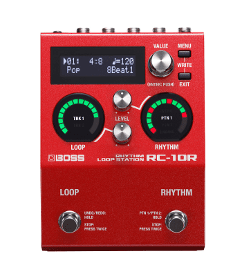

This looper has seen a lot of love. It gives me rhythm and alternating loop sections, and remains part of the portable board. At home it only passes audio through; the RC-600 handles both loops and drums at the end of the chain. I could remove the RC-10R from that arrangement, but haven't yet.

### [Boss FS-7 Footswitch](https://reverb.com/p/boss-fs-7-footswitch)
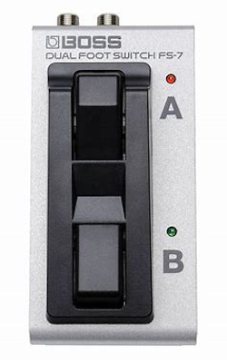

The external footswitch adds dedicated controls to the RC-10R, specifically tap tempo and a faster undo/redo option. Much preferable to bending over to turn a dial.

## Looping and Output

### [Boss RC-600 Loop Station](https://www.boss.info/global/products/rc-600/)
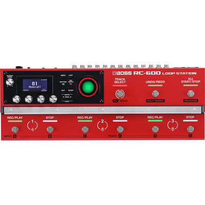

My big addition for 2026, a birthday present to myself. It's a beast. Six independent tracks let me lay down a bass line, add other layers, and then go back and completely change any of them. I am no longer limited by the latest undo/redo. I can try an alternative on a parallel track to compare, or delete and re-record the original without losing the other parts. That's the flexibility I hoped for, and it's proven true.

It has effects and a lot of customization that I'm not using yet. It's practically its own pedalboard.

### [Allen & Heath ZEDi-10 Compact 10-Input Hybrid Mixer/USB Interface](https://reverb.com/p/allen-and-heath-zedi-10-compact-10-input-hybrid-mixer-slash-usb-interface)
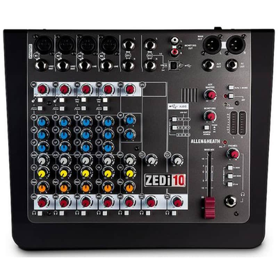

The mixer receives the two separate left/right stereo outputs of the RC-600. I can and have connected microphones and other inputs here directly, but generally I send things through the earlier stages so they can be looped.

What matters to me is controlling three levels separately: **recording output, headphones, and monitors**. I can record at the level I want, listen quietly on headphones, or switch on the monitor speakers without needing the same volume everywhere. My [previous mixer](https://reverb.com/p/behringer-xenyx-802s-8-channel-mixer-with-bluetooth-streaming) didn't quite let me control all of those independently, and that is the _only_ reason I felt the need to upgrade.

### HeadRush Speaker Monitors

I have a [HeadRush FRFR-108](https://reverb.com/marketplace?query=Headrush%20FRFR-108) and an [FRFR-108 MKII](https://reverb.com/marketplace?query=Headrush%20FRFR-108%20MKII) as a "full-range, flat-response" stereo pair for listening in the room. They can produce way more volume than I'll ever need in this room. Unlike running the Iridium into a guitar amp, these let the amp sim do its thing without sonic double dipping.

### Recording

USB audio from the mixer goes to a phone or iPad, using a USB-C adapter. Usually I'm recording on my iPad with the Blackmagic camera app, mounted on a tablet holder attached to a mic stand. The audio I'm recording is the output of the looping setup, not the device microphone. The iPad doesn't have the greatest camera, so I want to replace this part of the plan, but it does allow me to quickly transition to editing after recording.
